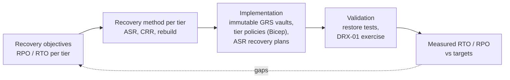
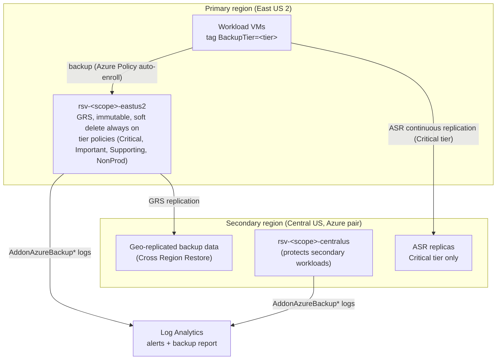

# Azure Disaster Recovery Engineering

Backup and disaster recovery designed from recovery objectives outward. Tiered RPO/RTO targets map to a recovery method per tier. Immutable, geo-redundant Recovery Services vaults and their tier policies (Critical, Important, Supporting, NonProd) are defined in Bicep. Azure Site Recovery handles failover for critical systems. Around that sit the runbooks, the dependency map, and a structured regional-failure exercise that turns the targets into measurements.

| | |
|---|---|
| Project type | Independently built design and lab code. It generalizes professional work in tiered immutable backup and ASR failover testing. No client data or configuration is included. |
| Local validation | Bicep build and lint clean; 22 Pester tests pass; PSScriptAnalyzer clean ([evidence](docs/validation/README.md)) |
| Cloud validation | Not yet deployed. No restore test or failover exercise has been run from this repository, so every RPO/RTO value here is a target, not a measurement. |

## Scenario: what's real and what this repo adds

This is a reference design built from my backup and disaster recovery work in production Azure environments. The environment here is fictional, and no real configuration is included.

What I've done in production:
- Set up immutable Recovery Services vaults per region and subscription.
- Rolled out VM and database backups under a tiered model, with backup frequency and long-term retention set by criticality.
- Documented backup coverage gaps and exceptions for stakeholder decisions.
- Run Azure Site Recovery test failovers for VMs protected across two Recovery Services vaults, and wrote the runbook and the test report for leadership and the technical team. I'm the escalation contact when a test fails.

Added for this repo:
- The environment itself (East US 2 primary, Central US secondary).
- The tier model below: its schedules, retention, RPO/RTO targets, and recovery methods are example values for this design.
- The Bicep for vaults and policies, auto-enrollment through Azure Policy with a `BackupTier` tag, and the immutability-lock script.
- The DRX-01 regional failure exercise, the dependency map, the failback runbook, and `Get-AsrReadiness.ps1`.

## Problem

Backups are often configured one VM at a time with default policies, never restore-tested, and stored somewhere a compromised admin account can delete. DR "plans" list VMs without the order they need to start in, the decision process, or a way to measure whether the targets were met. A ransomware event and a regional outage need different recovery mechanisms, and many designs only cover one of them.

## Approach



## Recovery tiers

| Tier | RPO target | RTO target | Method | Backup policy |
|---|---|---|---|---|
| Critical | 6 h backup / minutes replication | 4 h | ASR failover + immutable backup | Enhanced, every 6 h; 30 d / 8 w / 24 m / 7 y |
| Important | 24 h | 24 h | Cross Region Restore | Daily; 30 d / 8 w / 12 m |
| Supporting | 24 h | 72 h | CRR or rebuild from IaC | Daily; 30 d / 4 w |
| NonProd | 24 h | 1 week | Rebuild from IaC | Daily; 14 d |

Why each tier uses its method, and why critical systems need both replication and backup: [docs/recovery-objectives.md](docs/recovery-objectives.md).

## Architecture



## Engineering decisions and tradeoffs

| Decision | Reason | Tradeoff | Record |
|---|---|---|---|
| Immutable but unlocked at deploy; lock separately with evidence | A locked vault's retention can never be reduced, so a mistake becomes permanent | A short window where immutability could be disabled (soft delete still always on) | [ADR 0001](docs/decisions/0001-immutability-locked-separately.md) |
| One GRS vault per region, CRR enabled at creation | VM backup is regional; redundancy can't change after first use | Roughly twice the backup storage cost of LRS | [ADR 0002](docs/decisions/0002-one-vault-per-region-geo-redundant.md) |
| Recovery method chosen by RTO | Backup restores can't meet a 4 h RTO for a multi-tier app; replication can, but copies logical damage | Two mechanisms to test | [ADR 0003](docs/decisions/0003-recovery-method-by-tier.md) |
| Tier policies generated from one JSON file | Same policy names in every vault, so Azure Policy auto-enrollment works per region | Changing a policy changes it everywhere (intended) | [config](config/backup-tiers.json) |
| Domain controllers not in the ASR recovery plan | Restoring DCs from replicas risks USN rollback; a standing DC in the secondary region is the supported pattern | One always-on VM in the secondary region | [dependency map](docs/dependency-map.md) |

What happens when a dependency fails mid-recovery (VM won't boot, no capacity, DNS not updated, Key Vault unreachable): [dependency-map.md](docs/dependency-map.md#failure-handling-during-failover).

## Repository contents

| Path | Purpose |
|---|---|
| [`infrastructure/main.bicep`](infrastructure/main.bicep) | Regional vault (GRS, CRR, immutability, soft delete, diagnostics) and VM backup policies for each tier (Critical, Important, Supporting, NonProd) |
| [`config/backup-tiers.json`](config/backup-tiers.json) | Tier schedules, retention, and RPO/RTO targets |
| [`docs/recovery-objectives.md`](docs/recovery-objectives.md) | Definitions, targets, regional versus logical failure |
| [`docs/dependency-map.md`](docs/dependency-map.md) | Dependencies, recovery plan groups, failure handling |
| [`docs/auto-enroll-with-azure-policy.md`](docs/auto-enroll-with-azure-policy.md) | Tag-based backup enrollment, exemptions, coverage queries |
| [`exercises/DRX-01-regional-failure/`](exercises/DRX-01-regional-failure/plan.md) | Exercise plan (preconditions, scenario, steps, verification, failure handling) and results template |
| [`runbooks/`](runbooks/) | ASR test failover, backup restore validation, failback |
| [`scripts/Get-AsrReadiness.ps1`](scripts/Get-AsrReadiness.ps1) | Read-only replication health and recovery-plan inventory |
| [`scripts/Lock-VaultImmutability.ps1`](scripts/Lock-VaultImmutability.ps1) | Irreversible lock, gated on restore-test evidence |
| [`templates/dr-test-report.md`](templates/dr-test-report.md) | Leadership report for a completed test |

## Deployment

```bash
for region in eastus2 centralus; do
  az group create -n "rg-backup-$region" -l "$region"
  az deployment group what-if -g "rg-backup-$region" --template-file infrastructure/main.bicep \
    --parameters "infrastructure/environments/$region.bicepparam"
  az deployment group create  -g "rg-backup-$region" --template-file infrastructure/main.bicep \
    --parameters "infrastructure/environments/$region.bicepparam"
done
```

Then: enable auto-enrollment ([guide](docs/auto-enroll-with-azure-policy.md)), configure ASR replication and the `rp-orders` recovery plan for Critical-tier VMs, run a [restore validation](runbooks/backup-restore-validation.md), and only then [lock immutability](scripts/Lock-VaultImmutability.ps1).

Required roles: Backup Contributor (vaults, policies), Site Recovery Contributor (ASR), Resource Policy Contributor (auto-enrollment).

## Validation

```powershell
Invoke-Pester ./tests -Output Detailed
```

The tests check that RPO targets are achievable with each tier's backup frequency, instant-restore limits per policy type, that critical tiers never have weaker targets or shorter retention, the compiled vault's resilience settings, that IaC never deploys a locked vault, the lock script's safeguards, that the readiness script is read-only, and that every documentation link resolves.

The cloud-side validation is the [restore runbook](runbooks/backup-restore-validation.md) and [DRX-01](exercises/DRX-01-regional-failure/plan.md).

## Security

Immutability and always-on soft delete protect recovery points from deletion by a compromised account. Enhanced security for soft delete is enabled. Locking requires evidence and leaves an audit trail in tags. Test restores go to isolated networks only, to avoid duplicate identities on the production network. Restored VMs contain production data: clean them up immediately after validation.

## Cost considerations

Charges come from backup protected-instance fees (per VM, by size band), backup storage (GRS, roughly twice LRS; long yearly retention dominates over time), ASR per-instance fees for the Critical tier plus replica disks and cache storage, and restore-test compute and disks (short-lived). Retention is the biggest long-term lever: 10-year yearly points for Critical add up. Set them from a real requirement. Teardown: unlocked vaults can be deleted after stopping protection and deleting backup data, and soft delete keeps that data for 14 more days. Locked vaults can't have retention reduced. Don't lock lab vaults.

## Limitations and known gaps

- Not deployed. The backup policy JSON is type-checked by Bicep but hasn't been accepted by Azure yet.
- No measured RTO/RPO. DRX-01 hasn't been run.
- ASR replication and recovery plan configuration are documented procedures, not IaC.
- Database-native backup (Azure SQL long-term retention, PostgreSQL Flexible Server) is described in the objectives but not implemented here.

## Future improvements

1. Deploy to a lab subscription, run a restore validation, and publish the measured restore duration.
2. Run DRX-01 against a two-VM lab app and replace the targets table with target versus measured.
3. Add ASR (replication policy, protected items, recovery plan) to Bicep.
4. Add a Backup vault with PostgreSQL Flexible Server long-term retention to the same tiers.
