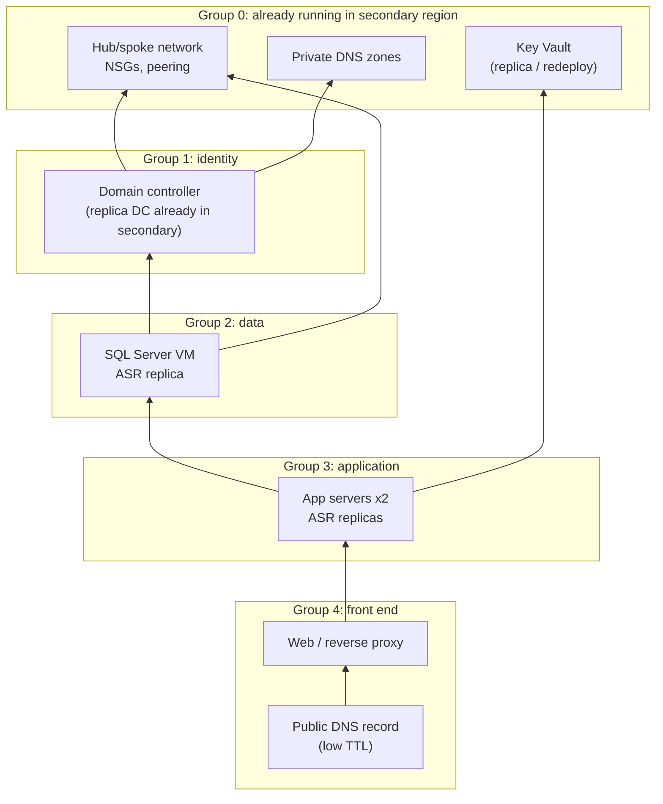

# Dependency map and failover sequencing

This map is for a representative three-tier line-of-business application (order processing). The same method applies to any workload: list what each component needs before it can start, then recover in dependency order.

## Dependencies

Arrows point from a component to what it needs.

## Recovery plan groups (Azure Site Recovery)

| Group | Components | Starts after | Validation before next group |
|---|---|---|---|
| 0 | Network, private DNS, Key Vault | Exists in advance (deployed by IaC in both regions) | Peering connected; Key Vault reachable through its private endpoint |
| 1 | Domain controller | A standing DC replica in the secondary region (not failed over: DCs replicate natively) | `nltest /dsgetdc:<domain>` from a test VM; DNS resolves internal names |
| 2 | SQL Server | Group 1 | SQL service running; databases online; `SELECT @@SERVERNAME` |
| 3 | App servers | Group 2 + script action: update the connection string if the database name changes | App health endpoint returns 200; app logs show a database connection |
| 4 | Web tier, public DNS | Group 3 + manual action: change the public DNS record or Front Door origin | Synthetic transaction (submit a test order) succeeds externally |

Domain controllers are deliberately not in the recovery plan. Failing over a DC from a replica can cause USN rollback. A permanently running DC in the secondary region replicates through AD itself, and is the supported pattern.

## Failure handling during failover

| Failure | Response |
|---|---|
| A group-2 VM fails to boot | Retry from the *latest app-consistent* recovery point. If it still fails, restore from backup (CRR) and continue. Record the RTO impact. |
| The app can't reach SQL | Check DNS (does the SQL name resolve to the new IP?), NSG rules in the secondary spoke, and the SQL listener |
| The secondary region lacks capacity for a VM size | Fail over that VM to an alternate size (ASR target settings), or wait. That's why capacity reservations matter for Tier 1. |
| Key Vault unreachable | The application can't get secrets: check the private endpoint and DNS zone link in the secondary region |
